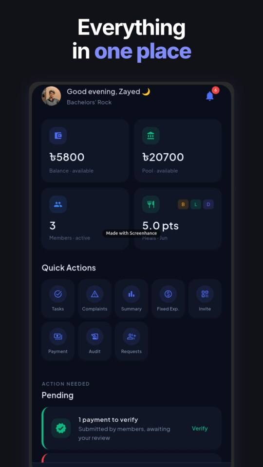
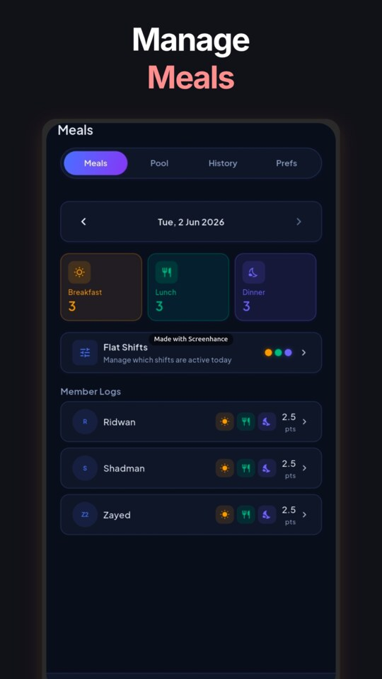
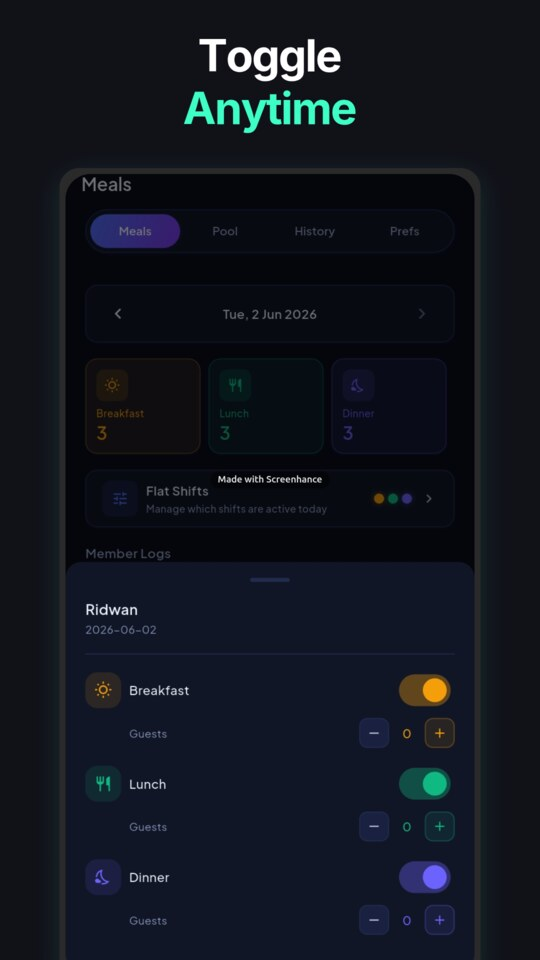
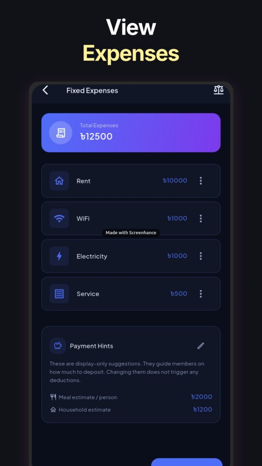

# Nirbhor

Shared flat management for bachelor housing in Bangladesh. Members mark the meals they eat, expenses are recorded and approved, wallets track who has paid what, and at the end of the month the app closes the books and shows every member exactly what they owe and why.

This repository is the Flutter app. The API lives in [nirbhor-api](https://github.com/mdzayedoyshik/nirbhor-api).

<a href="https://play.google.com/store/apps/details?id=com.techorbit.nirbhor">Get it on Google Play</a>

<p>
  
  
  
  
</p>

## Features

- **Meals:** members switch breakfast, lunch and dinner on or off per day, with guests. Meal cost is shared from a pool and calculated at month end.
- **Expenses and wallets:** household and grocery expenses go through approval, and each member's wallet shows deposits and deductions.
- **Monthly summary:** a clear breakdown of each member's balance when the month closes.
- **Members and roles:** manager, co-manager and member, with invites by QR code.
- **Tasks, complaints and an audit log** so everyone can see who changed what.
- **Notifications** through Firebase Cloud Messaging.

## Tech

Flutter · BLoC (flutter_bloc) · go_router · get_it · Firebase (Messaging, Crashlytics, Analytics, Remote Config) · Google Sign-In · fl_chart

The code follows a feature-first layout, with each feature split into `data`, `domain` and `presentation`:

```
lib/
├── core/        DI, network client, router, theme, caching, shared widgets
└── features/    auth, flat, member, meal, wallet, expense, summary, task,
                 complaint, notification, audit_log, feedback, onboarding, help
```

## Running it locally

1. Install Flutter (stable) and run `flutter pub get`.
2. Start the API locally, or point the app at your own deployment ([nirbhor-api](https://github.com/mdzayedoyshik/nirbhor-api)).
3. Copy `.env.example` to `.env.dev` and fill in `BASE_URL` and `GOOGLE_CLIENT_ID`. An empty `.env.prod` is enough for debug builds.
4. Firebase: the committed `google-services.json` and `firebase_options.dart` belong to the production project. For your own build, create a Firebase project and run `flutterfire configure`.
5. `flutter run`

## Contributing

Issues and pull requests are welcome. See [CONTRIBUTING.md](CONTRIBUTING.md).

## License

[MIT](LICENSE) © Md. Zayed Oyshik
